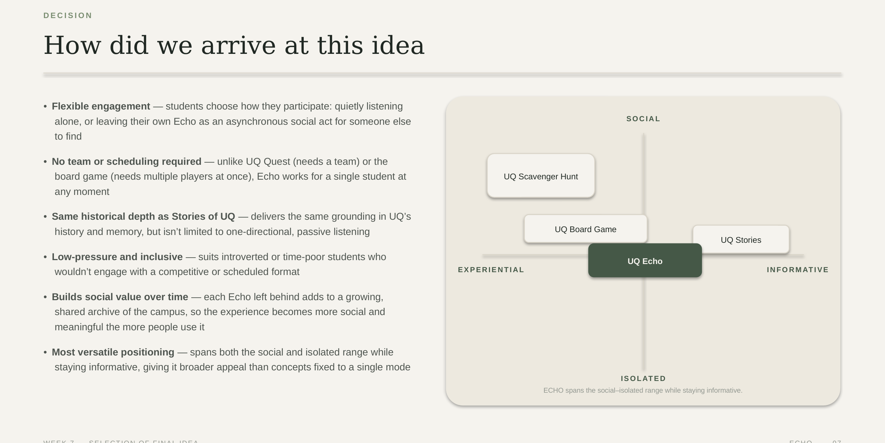
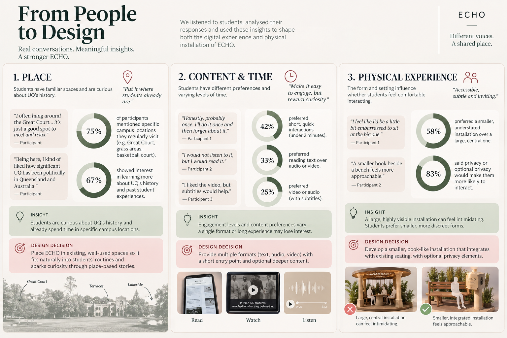
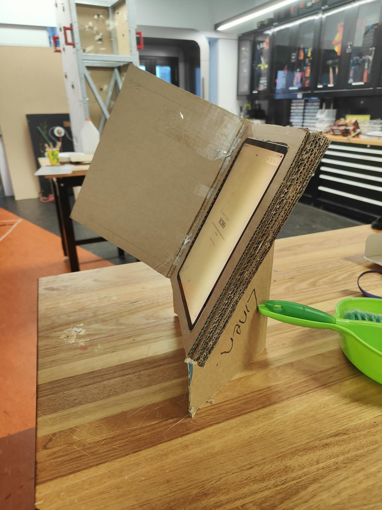
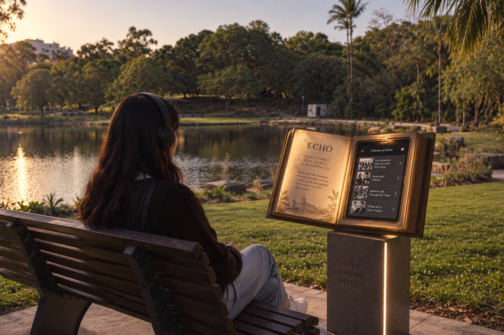
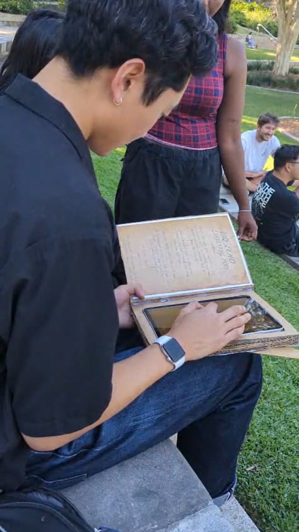
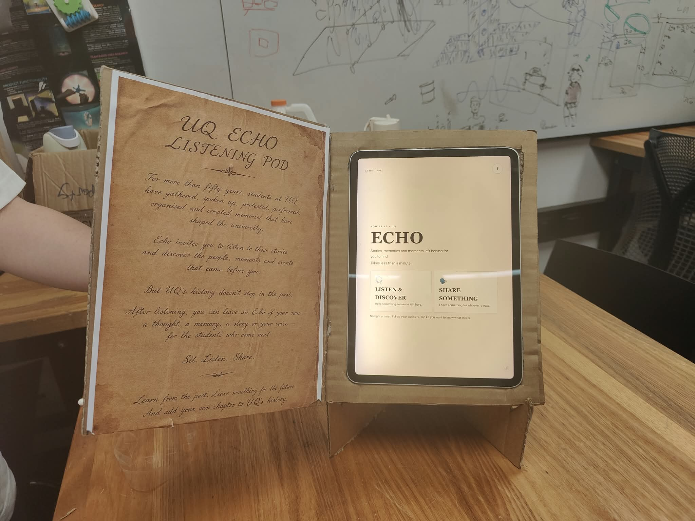
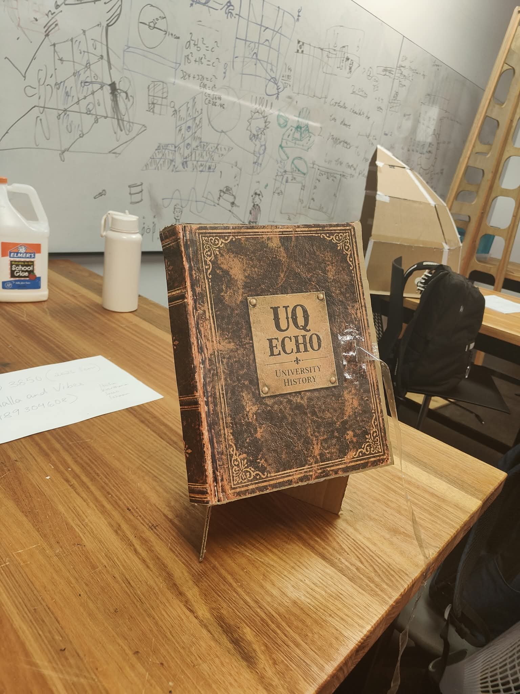

# ECHO — Design Process Overview

> **ECHO: Discover a story. Leave something behind.**  
> **DECO3500 Social & Mobile Computing — Semester 2, 2026**

This page records the project at Week 9. For the latest build and setup steps, see the [echo-tradeshow guide](../../../docs/prototype-guide.md).

ECHO is an interactive storytelling experience designed to connect students with UQ’s history, campus spaces and student experiences. Students can discover stories through audio, video or text, and leave their own memories, facts, questions or moments for other people to discover.

Our design goal was to create an experience that fits naturally into students’ existing routines, particularly during breaks, periods of downtime and moments when they are already spending time on campus.

---

## Project Links

Images on this page come from [the Week 9 images folder](../../../docs/process/week-09/images/).

- [Poster and promotional material](../../../docs/exhibition)
- [Current prototype — echo-tradeshow](../../../prototype/index.html)
- [GitHub repository](https://github.com/Inseo-Park/DECO3500_Inshallah-and-Vibes)
- [Week 9 stand-up documentation](../../../docs/process/week-09)
- [Week 9 interview findings](../../../docs/process/week-09/interview-quotes.md)
- [Ethical considerations](ethical-considerations.md)

> **Prototype note:** The digital prototype is an early proof of concept. It is not a fully deployed product and some interactions are demonstrated through prototype screens or Wizard-of-Oz facilitation.

---

## Prototype Access and Instructions

### Opening the Week 9 prototype

1. Download or clone the repository to your computer.
2. Open the [echo-standup folder](../../prototypes/echo-standup/).
3. Open `index.html` in a browser. Keep the `media/` folder beside it so the recordings and pictures load.

The prototype files are already extracted. The [stand-up README](../../prototypes/echo-standup/README.md) explains how to export session records and lists the build’s limits.

### Exploring the prototype

Users can:

1. Enter the ECHO experience.
2. Choose between **Listen & Discover** and **Share Something**.
3. Select a story category or allow the experience to surprise them.
4. Experience a story through audio, video or text.
5. Respond to the story and describe what stayed with them.
6. Decide whether to leave an Echo for another student.

---

## 1. Project Overview

Our research identified an opportunity to help students connect with UQ’s history and campus identity in ways that feel relevant to everyday student life. Although students may be interested in campus stories, they do not always encounter this information naturally while moving between classes, studying or relaxing.

Instead of developing a conventional historical display, we explored a place-based storytelling experience that combines:

- Historical stories connected to UQ locations.
- Memories and experiences from students and other community members.
- Flexible content formats, including audio, video and text.
- Optional participation without requiring a team or scheduled activity.
- A physical installation integrated into familiar campus spaces.
- The ability to leave an Echo for another person to discover later.

The concept of an “Echo” creates an asynchronous social connection: one person leaves something behind, and another person encounters it at a later time.

*Figure 1. Early ECHO concept visualization showing the proposed interaction direction and campus setting.*

---

## 2. Design Process Timeline

| Week | Focus | Outcome |
|---|---|---|
| Week 6 | Idea generation and initial testing | Four concepts were explored and compared. |
| Week 7 | Concept selection | ECHO was selected as the final design direction. |
| Week 8 | Digital prototyping and user evaluation | The interaction flow and content preferences were tested. |
| Week 9 | Iteration and re-planning | Findings informed the physical and digital prototype direction. |

---

## 3. Week 6 — Exploring Initial Ideas

During Week 6, the team explored four different concepts related to campus history, discovery, interaction and belonging.

### UQ Board Game

The board game used team-based collection mechanics, clues and historical artefacts. Testing suggested that the purpose was easy to understand, but the activity could become too time-consuming or feel like “assigned fun.” Simple trivia also risked limiting the depth of learning.

### UQ Stories

UQ Stories was a digital storytelling platform containing short stories about campus history and lived experiences. Participants found the website intuitive and responded positively to stories connected to real locations. An interactive map was identified as a possible future improvement.

### Scavenger Hunt

The scavenger hunt used QR codes and physical movement around campus. Participants liked the idea of scanning a location to access information, but the concept required users to actively travel between locations and could be difficult to complete during short breaks.

### Story Pods

Story Pods proposed a quiet, semi-private listening and sharing space. Participants responded positively to the idea of discovering something left by another student and found audio combined with visuals engaging. However, a large enclosed structure could feel intimidating, leading to the decision to explore a smaller and more understated form.

*Figure 2. Summary of themes, evidence, insights and design decisions derived from student feedback.*

---

## 4. Week 7 — Selecting ECHO

ECHO was selected because it allowed students to participate flexibly without requiring a team, a fixed schedule or extended gameplay.

Compared with the other concepts, ECHO could:

- Be used by one student at almost any time.
- Support both individual and social experiences.
- Offer the historical depth of UQ Stories while allowing user contribution.
- Accommodate different attention spans and content preferences.
- Work in existing campus spaces.
- Build social value over time as more students leave stories and memories.

The final concept combined place-based historical storytelling, student contributions, optional participation and a physical installation. The design aimed to span the space between isolated and social experiences while remaining informative and accessible.

---

## 5. Week 8 — Developing the Digital Prototype

The digital prototype was developed before committing to a final physical installation. This allowed the team to test the experience structure and content preferences with less time and material investment.

The main interaction flow included:

1. Entering the ECHO experience.
2. Understanding what an Echo is.
3. Choosing between discovering and sharing.
4. Selecting a story category.
5. Experiencing a story through different media.
6. Responding to the story.
7. Deciding whether to leave an Echo for another student.

The prototype explored audio, video and text-based content. This was important because students have different preferences for consuming information, and a single format could exclude some users. Accessibility considerations also led to the inclusion of subtitles or text alternatives where appropriate.

---

## 6. User Evaluation

The user evaluation investigated usability, interest in UQ stories, content preferences, engagement time and comfort when interacting in public spaces.

### What we wanted to understand

- Would students engage with campus stories?
- Would they explore the experience independently?
- Which content formats would they prefer?
- Would they prefer short or more immersive stories?
- Would they feel comfortable interacting in a public setting?
- Would they want to leave something for another student?

### What we observed

Engagement varied between participants. Some users explored briefly and preferred a quick interaction, while others spent longer engaging with the content. Media preferences also differed: participants responded to different combinations of audio, video and text.

The physical form influenced comfort. A smaller, understated installation appeared more approachable than a large enclosed pod because users wanted to remain aware of their surroundings and avoid feeling overly exposed.

Location-based storytelling remained important. Connecting stories to specific campus spaces made the information feel more relevant and helped link historical content to students’ existing experiences.

*Figure 3. User evaluation of the ECHO prototype in an outdoor campus setting.*

*Figure 4. Students interacting with the prototype and discussing the experience.*

---

## 7. What Changed After Testing?

### Physical installation

The initial direction involved a larger listening pod with a semi-private listening experience. Feedback suggested that a large enclosed structure could feel intimidating or attract unwanted attention.

The design therefore moved towards:

- A smaller, book-inspired installation.
- Integration with existing seating areas.
- Optional privacy without completely enclosing the user.
- A tablet or screen for the main interaction.
- A subtle activation cue, such as lighting.
- Visibility of the surrounding environment.
- A form that invites participation without forcing it.

*Figure 5. Updated ECHO design direction following testing and iteration.*

### Digital experience

The digital prototype was refined to include:

- A clear entry point.
- Simple navigation.
- Multiple content formats.
- Short stories with optional deeper exploration.
- Location-based content.
- Opportunities to leave an Echo.
- A low-pressure interaction flow.
- Reflection prompts following each story.

These changes helped align the prototype with the central insight that students are more likely to engage when the experience is accessible, optional and integrated into existing routines.

---

## 8. Prototype Direction at Week 9

At Week 9, the ECHO concept consisted of two connected parts.

### Physical installation

The physical installation is intended for familiar campus spaces such as seating areas, lawns and locations around UQ Lakes. The proposed structure may include a book-shaped form, a screen or tablet, subtle lighting and a hinge mechanism that allows the book to open.

The physical form is still a concept direction rather than a fully engineered product. Due to the short project timeline, low-fidelity materials and Wizard-of-Oz interactions were prioritised.

The team also produced a low-fidelity physical prototype using cardboard and a tablet. This prototype was used to explore the scale, screen placement, viewing angle and relationship between the physical enclosure and the digital interface.

*Figure 6. Low-fidelity physical prototype showing the tablet integrated into a cardboard enclosure.*

*Figure 7. Side view of the physical prototype showing its structure, viewing angle and support.*

### Digital experience

The digital experience is the main storytelling interface. Users can listen to a story, watch a visual story, read supporting information, choose a story category, respond to an Echo and leave a memory, fact, question or moment for another user.

*Figure 8. Current concept direction for the ECHO installation and its digital storytelling interface.*

---

## 9. Future Development and Implementation Plan

The next stage of ECHO is to develop a **fully working physical installation** rather than keeping the interaction at the low-fidelity or Wizard-of-Oz level. The final installation will combine a book-inspired physical structure, an interactive touchscreen, proximity detection, automatic lighting and a controlled opening mechanism to make the experience feel discoverable and welcoming.

The installation will be designed to respond when a person approaches. A proximity sensor will detect someone entering the interaction area, which will trigger a subtle lighting sequence and automatically open the book-like structure. This activation is intended to communicate that ECHO is interactive without requiring students to press a button or already understand what the installation does. Once the structure opens, the touchscreen will become the primary interface for listening, watching, reading, responding and leaving an Echo.

### Planned Arduino and electronic components

The following components will support the physical interaction system:

- **Arduino-compatible microcontroller or ESP32:** Controls the sensors, lighting and opening mechanism, and communicates with the touchscreen system where required.
- **Proximity sensor:** A PIR motion sensor or, preferably, a time-of-flight distance sensor to detect when a person approaches the installation.
- **Servo motor or geared motor with a suitable driver:** Opens and closes the book-like physical panels. A servo can be used for an early prototype, while a stronger geared motor or linear actuator may be selected for a full-scale installation.
- **Limit switches or position sensors:** Detect when the structure is fully open or closed and help prevent the motor from continuing to move beyond its safe position.
- **Addressable LED strip or LED ring:** Provides a subtle glow when a person approaches and indicates that the installation is ready to interact with.
- **MOSFET or LED driver module:** Controls the lighting safely when the selected LEDs require more current than the microcontroller can provide directly.
- **External power supply and voltage regulator:** Supplies stable power to the microcontroller, LEDs and motor system. The motor and lighting power requirements will be calculated before construction.
- **Touchscreen tablet or display:** Provides the digital ECHO interface. The screen will support touch interaction and will launch or display the digital prototype experience.
- **Push button or emergency stop control:** Provides a manual override for testing, maintenance and safe shutdown if needed.
- **Wiring, connectors, breadboard or prototyping board and enclosure mounts:** Supports the initial circuit build and the later integration of components into the physical structure.

### Planned build process

1. **Refine the physical design:** Finalise the dimensions, viewing angle, hinge placement, screen position and opening range of the book-inspired installation.
2. **Build the structural frame:** Construct a stronger prototype using plywood, foam board, laser-cut components or another suitable material. Include secure mounting for the touchscreen, motor, LEDs and electronics.
3. **Prototype the proximity interaction:** Connect the proximity sensor to the microcontroller and test different detection distances so that the installation activates only when someone is close enough to engage.
4. **Add the lighting response:** Program a subtle light-up sequence that communicates presence and invites interaction without being distracting in the campus environment.
5. **Develop the automatic opening mechanism:** Connect the servo, geared motor or linear actuator. Program the structure to open when proximity is detected and close only when the interaction has ended or the system is reset.
6. **Add position and safety controls:** Use limit switches or position sensors to identify the open and closed states. Test the mechanism slowly and include a manual override to reduce the risk of trapping fingers, over-rotation or motor strain.
7. **Integrate the touchscreen:** Mount the touchscreen securely and connect it to the ECHO digital experience. The screen will begin at the landing page and allow users to touch through the Listen & Discover and Share Something pathways.
8. **Connect the physical and digital states:** Coordinate the lighting, opening movement and screen states. For example, approaching the installation triggers the lights and opening sequence, while the screen displays the ECHO welcome screen once the installation is ready.
9. **Test the complete interaction loop:** Test approach detection, lighting, opening, touchscreen interaction, audio playback, story selection, contribution and reset behaviour as one continuous experience.
10. **Conduct campus-based evaluation:** Test the working installation in a suitable campus setting to evaluate visibility, accessibility, comfort, interaction distance, sound levels, privacy and whether the activation encourages voluntary engagement.
11. **Refine for deployment:** Improve the enclosure, weather protection, cable management, component security, maintenance access and reliability before considering a more permanent installation.

### Intended automatic interaction sequence

The planned experience will follow this sequence:

**Approach → Detect → Light up → Open → Touchscreen welcome → Explore an Echo → Respond or leave an Echo → End interaction → Reset**

The system should remain inactive when no one is nearby, use a subtle visual cue when someone approaches, open smoothly, and return to its resting state after the interaction. The touchscreen will remain the main storytelling interface, while the physical movement and lighting will make the installation visible, responsive and inviting.

### Further testing and refinement

The working installation will be evaluated through additional testing focused on:

- Interaction in real campus locations.
- Accessibility, reach, viewing angle and physical comfort.
- Appropriate proximity detection distance and activation timing.
- Safe, smooth and reliable opening and closing movement.
- Lighting brightness and whether the activation is noticeable without disrupting the surrounding space.
- Story length, audio volume, subtitles and content format.
- Privacy, consent and moderation of contributed stories.
- Whether students return to the experience and contribute over time.
- How the installation can represent different voices respectfully and accurately.

---

## 10. Team Contributions

The project was developed collaboratively by all four team members. Team members contributed to idea generation, research discussions, concept comparison, prototyping, user testing, analysis and iteration.

### Itisha Srivastava
I contributed to the development of ECHO throughout the design process, beginning with the initial pod/ear concept to listen and share stories that happened in UQ and participating in the analysis of the four proposed ideas before the team selected ECHO as our final concept. I helped develop the concept further by creating the storyboard, designing the digital prototype, and contributing to the planning of the user experience and interaction flow. I was involved in conducting user testing and analysing the findings from all four participants to identify key insights and areas for improvement. I also contributed to the design and construction of the physical cardboard installation alongside my teammates, helping translate the digital concept into a tangible interactive experience. Additionally, I contributed to documenting our design decisions, evaluation findings, and plans for the physical installation and hardware implementation in the project Wiki.

### Ishandeep Singh
My contributions to the team included creating the low-fidelity UQ Stories prototype, which allowed students, alumni, staff, Indigenous community members, and others to share and interact with location-specific stories across the university campus. I conducted user testing of this prototype with three students and documented their feedback in our GitHub repository. I also contributed to the finalisation and selection of our final concept, UQ Echoes. Throughout the project, I consistently maintained and organised the GitHub repository according to the project brief, creating folders for each team member’s prototypes and user-testing materials, adding interview transcripts, and cleaning up the repository to ensure all documentation was easy to access. I created and managed the project’s GitHub issues, assigned tasks to the relevant team members, tracked their progress, and closed issues as they were completed. I also communicated consistently and effectively with my team, both in person during studio sessions and through our Discord channel, keeping team members informed about tasks, progress, and any changes made throughout the project.

### Keerthana Balamurugan
I contributed to the user research, ideation, interaction design, prototyping, and user testing of ECHO. I interviewed UQ students and alumni about their engagement with UQ history, then analysed the findings with my teammates using affinity mapping to identify key themes and user needs. I proposed 6–10 concepts, including the UQ board game, which I tested through user interviews. After selecting ECHO as our final concept, I helped develop the interaction flow, book-based interface, digital prototype, and user experience. I conducted two rounds of user testing with around 10 participants, analysing both sets of results: the first focused on evaluating whether our UI was understandable and usable, while the second evaluated whether the physical book prototype and interaction made sense to users. I used these findings to inform design iterations, developed the Wizard-of-Oz prototype for our demo, and helped construct the physical cardboard book installation. In the future, I plan to use Arduino, distance sensors, and servo motors to make the book automatically open and use lighting to create a more responsive physical interaction.

### Inseo Park
Throughout the ECHO project, my key contributions were design ideation, prototyping, physical fabrication, and user testing. After brainstorming concepts with my team in Figma, I designed low-fidelity wireframes for a mobile scavenger hunt app that guided users across the UQ campus to learn about historical figures, artifacts, and architecture. I mapped the user flows and conducted initial usability testing to gather feedback. Once our history-storytelling direction was finalized, I fabricated a book-style physical housing for ECHO using cardboard in the GP South workshop. By embedding my iPad into the custom enclosure to run our digital prototype, I demonstrated how the final form factor would look and feel, ultimately leading additional on-campus user testing sessions to evaluate student interactions and collect qualitative feedback.

---

## Additional User Testing 2 — Physical Prototype and Wizard-of-Oz Evaluation

A second round of testing was conducted using the low-fidelity cardboard ECHO prototype, a printed book cover and a tablet to simulate the intended interaction. The Wizard-of-Oz approach allowed us to evaluate the physical form, screen placement, viewing angle and how users approached the book-inspired installation before implementing the complete hardware system.

The testing helped us examine whether the physical object communicated its purpose and whether users could understand the relationship between the physical book and the digital storytelling interface. It also supported the direction of ECHO as an approachable, place-based experience where students can listen to stories, discover contributions from others and leave an Echo of their own.

The prototype was tested as an early representation of the final installation rather than a fully functional automated system. The findings will inform future refinement of the physical structure, accessibility, interaction distance and planned hardware components.

*Figure 9. User interacting with the ECHO Wizard-of-Oz prototype in an outdoor campus setting.*

*Figure 10. Open ECHO prototype showing the printed book cover, tablet interface and physical structure.*

*Figure 11. Closed ECHO prototype showing the book-inspired exterior and physical form.*

---

## 11. Final Reflection

ECHO developed through an iterative process of exploring concepts, testing assumptions and responding to student feedback. The project moved away from large, competitive or highly structured activities and towards a flexible experience that students can discover during existing moments of downtime.

The most important design learning was that engagement depends not only on the content itself, but also on when, where and how the experience is encountered. Students have different amounts of time, different media preferences and different levels of comfort when interacting in public spaces.

ECHO therefore combines a low-pressure physical invitation with a digital experience that supports listening, watching, reading, responding and contributing. The next stage would be to test the installation in a real campus environment, refine the interaction details and further evaluate how ECHO could become an approachable part of everyday campus life.
