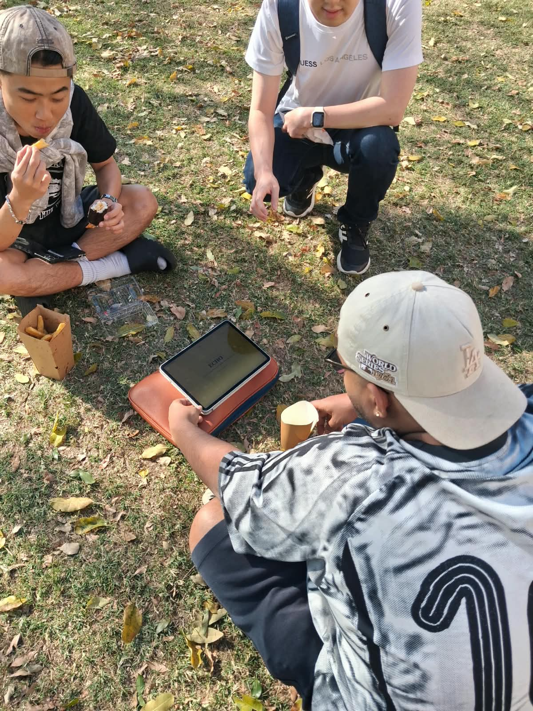
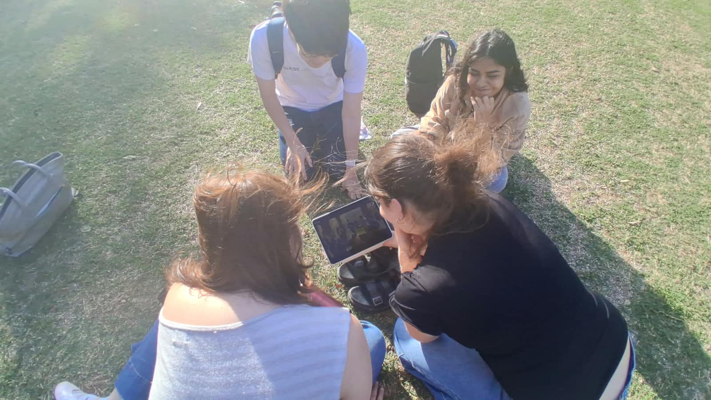
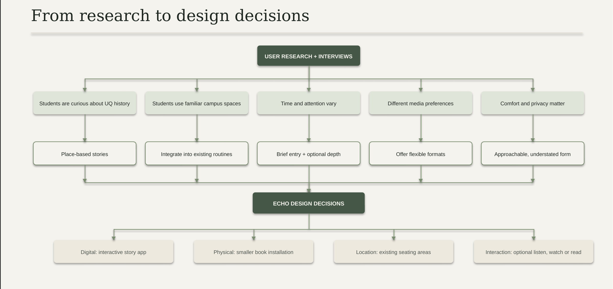
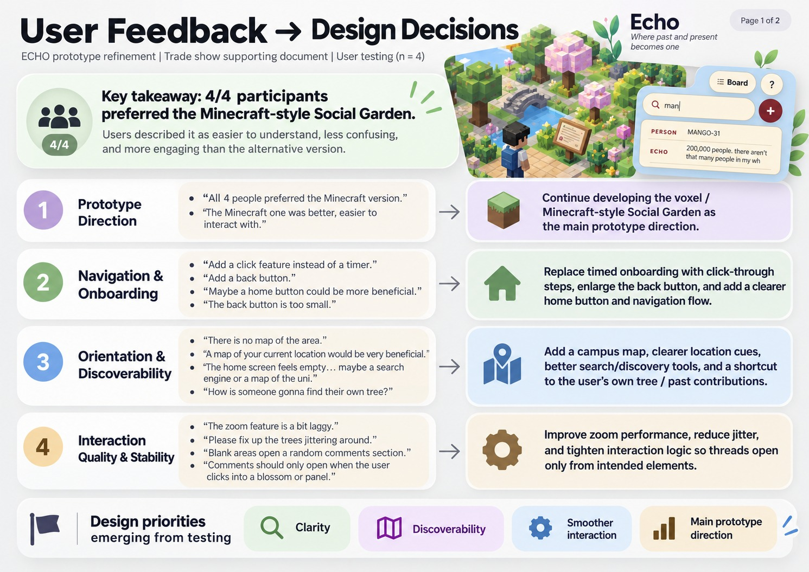
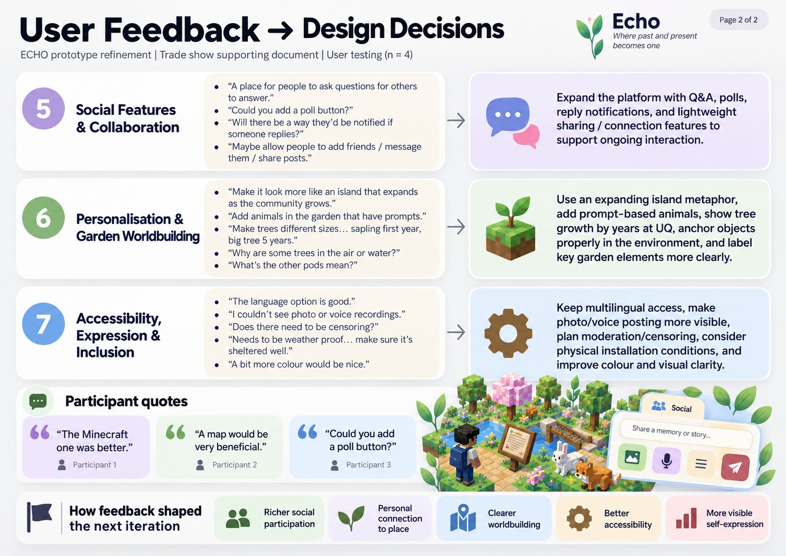
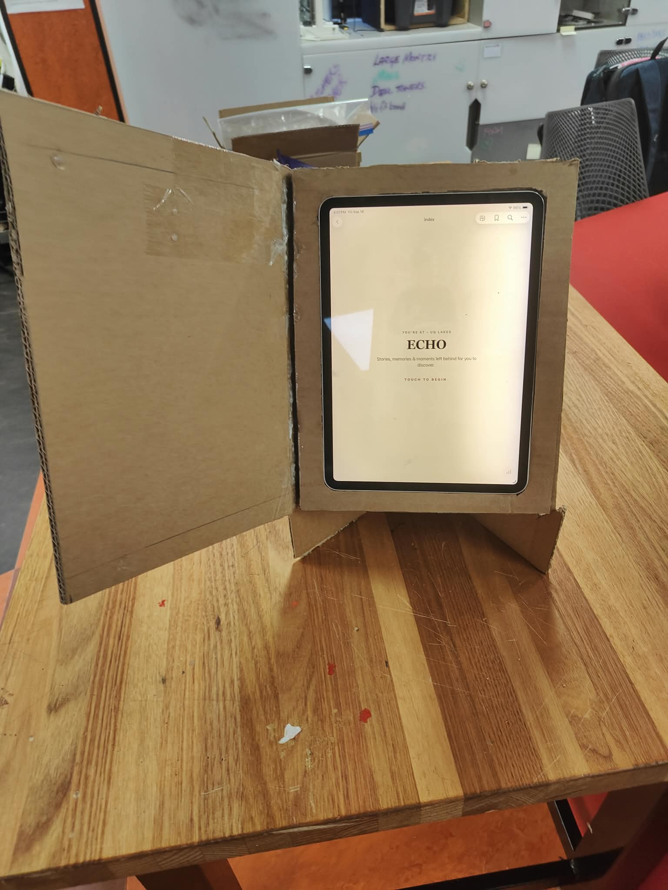

# ECHO — Design Process Overview

> **ECHO: Discover a story. Leave something behind.**  
> **DECO3500 Social & Mobile Computing — Semester 2, 2026**

ECHO is a place-based storytelling experience that connects UQ's history with the experiences students create today. Small, book-shaped installations are placed in familiar campus locations, while a digital experience lets students discover stories, add to existing threads and connect through a shared, Minecraft-inspired campus world.

Our aim is to help students—especially new and international students, and people who prefer lower-pressure ways of socialising—feel more connected to UQ beyond the classroom. ECHO now brings together two connected digital spaces: **Discover UQ**, where stories are organised into themed threads, and the **UQ Social Garden**, where anonymous contributions grow into a shared campus landscape.

---

## Project Links

> **Image note:** Supporting images are stored in `docs/process/week-09/images/` and the Week 9 folder. This page links to the existing image files.

- [Poster and promotional material](https://github.com/Inseo-Park/DECO3500_Inshallah-and-Vibes/tree/main/docs/exhibition)
- [Digital prototype — ECHO](https://github.com/Inseo-Park/DECO3500_Inshallah-and-Vibes/tree/main/prototype)
- [GitHub repository](https://github.com/Inseo-Park/DECO3500_Inshallah-and-Vibes)
- [Week 9 stand-up documentation](https://github.com/Inseo-Park/DECO3500_Inshallah-and-Vibes/tree/main/docs/process/week-09)
- [User research and interview findings](https://github.com/Inseo-Park/DECO3500_Inshallah-and-Vibes/blob/main/docs/evaluation/social-garden-feedback.md)

> **Prototype note:** ECHO is an evolving proof of concept, not a fully deployed campus service. The book prototype and Arduino-based approach interaction demonstrate the physical entry point; the digital prototype communicates the core experience. The complete seven-location network and all live social behaviours still require ongoing implementation, moderation planning and evaluation before any permanent deployment.

---

## Prototype Access and Instructions

### Downloading the digital prototype

1. Open the [ECHO prototype archive](https://github.com/Inseo-Park/DECO3500_Inshallah-and-Vibes/tree/main/archive/prototypes).
2. Download the prototype ZIP file from GitHub.
3. Extract the ZIP file and locate the main prototype file.
4. Open it in a modern browser such as Google Chrome, following any instructions included in the folder.

### Exploring the current concept

1. Enter ECHO and create an anonymous ID, or use one generated by the experience.
2. Choose **Discover UQ** or the **UQ Social Garden**.
3. In Discover UQ, browse themes and story threads; view content as text, audio or video.
4. Like or comment on contributions, add photos, audio, video or text to a thread, or create a new thread under an existing theme.
5. Use **Reel Mode** to swipe through content connected to a selected topic or thread.
6. In the Social Garden, explore your tree, revisit contributions and saved threads, and discover other users' trees and Echoes.
7. Explore the landmark connected to the current ECHO location. Other landmarks are shown as unavailable from that location, encouraging students to visit another ECHO site to discover its stories.

Some cross-location features—such as live user presence, chat and a fully connected seven-location network—remain part of the intended experience and need further implementation and evaluation.

---

## 1. Project Overview and Problem Space

UQ has a rich history, but many stories behind its places, people and events go unnoticed in everyday campus life. Our interviews suggested that students can be curious about campus heritage but may not have the time, context or accessible format needed to explore it. New and international students may also be learning how to navigate campus and find a sense of belonging.

Students already have familiar places where they study, relax or spend time between classes. Instead of asking them to attend a separate event or complete a long resource, ECHO brings stories into those existing routines. It connects three things: **the place where a story belongs, the people who contribute to it, and the students who discover it later.**

*Figure 1. Early concept-selection rationale comparing ECHO with alternative ideas.*

---

## 2. Design Process Timeline

The project evolved through a sequence of research, prototyping and refinement. The weekly timeline is a quick reference; the sections that follow explain how the evidence led to each change.

| Week | Focus | What changed or was learned |
|---|---|---|
| **6–7** | Initial research, four concepts and selection | The team moved from comparing a board game, UQ Stories, a scavenger hunt and Story Pods to a flexible, place-based ECHO concept. |
| **8** | Digital prototype and first evaluation | Ten logged sessions suggested that discovery was the easiest entry point; contribution worked better as an option after exploration. |
| **9** | Cardboard book and Wizard-of-Oz testing | Feedback moved the physical direction away from a large pod towards a small book beside familiar seating. |
| **10** | Social Garden development, third user-testing round and refinement | Four trade-show participants preferred the Minecraft-style Garden; their feedback highlighted navigation, map clarity, interaction stability and richer social actions. |
| **11** | Arduino and proximity-triggered book mechanism | The team built and tested the sensor setup so the book opens when someone approaches, bringing the physical and digital interaction closer together. |
| **12** | Final prototype refinement, showcase and documentation | The current prototype, exhibition poster, pamphlet and design evidence were brought together; remaining opportunities were recorded for future work. |

---

## 3. The Design Journey: From Hidden History to a Shared Campus World

### Starting point — comparing concepts and finding the right interaction

During early concept exploration, the team considered four directions:

- **UQ Board Game:** made history collaborative, but risked becoming time-consuming or feeling like assigned fun.
- **UQ Stories:** made location-based history easy to browse, but needed a stronger reason for people to return or add their own perspective.
- **Scavenger Hunt:** encouraged physical exploration, but required students to travel between locations and could be difficult during short breaks.
- **Story Pods:** offered a quiet way to listen and share, but a large enclosed structure could feel intimidating or attract unwanted attention.

The team selected ECHO because it could fit into an existing break, work for one person at a time, offer different levels of engagement and let a story continue after its original contributor had left. The first physical direction grew out of the Story Pod / listening-pod idea, but testing showed that the experience needed to feel smaller, more casual and easier to approach.

*Figure 2. Summary of themes, evidence and design decisions from early student feedback.*

### Prototype 1 — test the digital experience before committing to the object

The first digital prototype tested the basic journey: enter ECHO, choose to discover or share, select a category, experience a story and optionally leave an Echo. It offered text, audio and video so the team could learn whether students wanted one format or a choice.

The first logged test took place on **16 September 2026** and recorded **10 sessions**:

- **8/10** sessions chose Listen & Discover first.
- **4/10** sessions left an Echo, although only **2** began by choosing Share.
- **5/8** sessions that started with listening chose video first.
- The poster synthesis recorded that all users who reacted to content described their reaction as **“Curious.”**

The key insight was that discovery was the more natural first step. The experience should not ask someone to contribute before they have found something meaningful. This led to a discovery-first journey, with contribution as an optional next action.

### Prototype 2 — use the physical book to test comfort, scale and approachability

The next round used a cardboard book, a printed cover and a tablet to simulate the installation through a Wizard-of-Oz setup. This let the team evaluate scale, screen placement, viewing angle and interaction in a public campus setting before automating the mechanism.

Testing showed that a large, show-like installation could make users feel exposed. One participant said the larger concept felt like “I'm sitting in front of everyone,” while a different participant wanted a very quick way to contribute because they were between classes and did not have much “thought power.” Another liked “the aspect of leaving something to the next person.” Students also noticed overlooked campus details, including native berries and plants in a garden.

These findings drove the move from a larger pod to a **small book beside existing seating**. The book is closed when idle and opens when someone approaches; the screen inside becomes the main storytelling interface. The intended interaction is an invitation, not a public performance.

*Figure 3. User evaluation of the ECHO prototype in an outdoor campus setting.*

*Figure 4. Students interacting with the prototype and discussing the experience.*

*Figure 5. Flowchart connecting user research themes to design decisions.*

*Figure 6. User interacting with the ECHO Wizard-of-Oz prototype in an outdoor campus setting.*

*Figure 7. Open ECHO prototype showing the printed book cover, tablet interface and physical structure.*

*Figure 8. Closed ECHO prototype showing the book-inspired exterior and physical form.*

### The next design question — how can individual traces become social?

The early experience could let a student leave a contribution, but the team felt that comments and individual posts alone did not make the wider social experience visible. This led to the **UQ Social Garden**, developed alongside Discover UQ rather than as a separate unrelated app.

**Discover UQ** became the content and conversation layer. It uses horizontal themes and threaded content, including student protests and political history, people who came before us, First Nations histories, art, food and restaurants, campus culture and other UQ experiences. Curated stories sit alongside user-created threads. Students can watch, listen or read; like or comment on contributions; add photos, audio, video or text; and create new threads under an existing theme. A thread about Vietnam War-era student activism, for example, can hold historical material and continue with students' perspectives, images or related stories.

**Reel Mode** offers a quicker way to browse content associated with a selected topic or thread. It is intended as an easier entry point during a short break, while keeping content tied to a subject rather than making the experience a random feed.

**The UQ Social Garden** makes the social layer visible. Each anonymous user is represented by a character and has a tree; every Echo, thread or contribution grows into a flower on that tree. Users can revisit their contributions and saved threads, explore other people's trees and discover the stories they have left behind. The map is tied to physical locations: the landmark for the current ECHO site is open, while other landmarks are covered or unavailable until a student visits the corresponding location. This makes the Garden both a record of participation and a reason to explore other parts of UQ.

The concept also includes live avatars representing users at other ECHO locations, with options to visit trees, use quick actions and chat or form groups. These cross-location interactions are part of the intended social experience and require further implementation and evaluation before being treated as a validated outcome.

*Figure 9. Concept direction showing the relationship between the physical installation and the digital storytelling experience.*

### Prototype 3 — trade-show feedback refined the Social Garden (Week 10)

A third round of feedback evaluated the Social Garden direction with **four participants**. The clearest result was that **4/4 participants preferred the Minecraft-style Social Garden** over the alternative version, describing it as easier to understand, less confusing and more engaging.

The feedback also surfaced practical issues and opportunities:

- **Navigation and onboarding:** users asked for click-through steps instead of a timer, a clearer back button and a more visible home button.
- **Orientation and discoverability:** participants wanted a campus map, a clear current-location cue, better search/discovery tools and a shortcut back to their own tree or previous contributions.
- **Interaction quality:** feedback identified zoom lag, tree movement/jitter and blank comment areas opening unexpectedly as issues to fix.
- **Social connection:** participants suggested Q&A, polls, reply notifications and ways to add friends or message one another.
- **Garden world-building:** suggestions included an island that expands as the community grows, prompt-based animals, trees that show growth over time and clearer labels for key objects.
- **Accessibility and inclusion:** participants liked the language option and asked for clearer photo/voice controls, visible moderation or censorship safeguards, improved colour clarity and consideration of weather protection for the physical installation.

This round strengthened the Minecraft-style Garden as the main direction and created a clearer refinement list. Navigation, location cues, interaction stability and contribution visibility were treated as immediate design priorities. Ideas such as polls, Q&A and more elaborate garden personalisation remain opportunities for continued iteration rather than being presented as validated final features.

*Figure 10. Trade-show feedback, page 1 of 2: preferred Garden direction and interface issues identified by four participants.*

*Figure 11. Trade-show feedback, page 2 of 2: social interaction, world-building, accessibility and inclusion recommendations.*

### Prototype 4 — connecting the physical book to the interaction (Week 11)

The team then developed the Arduino-based physical interaction. A proximity sensor detects when someone comes close to the book and triggers the opening mechanism, revealing the screen inside. This moves the book beyond the earlier Wizard-of-Oz simulation and makes the relationship between approach, opening and digital discovery tangible.

The work focused on getting the sensing and opening interaction to operate as part of the prototype and refining how the physical object, screen and user journey fit together. It is a working prototype interaction, not yet a weatherproof, permanent campus installation.

*Figure 12. Book prototype with the tablet integrated into the physical enclosure.*

*Figure 13. Side view showing the physical structure and viewing angle.*

### Final integration and showcase (Week 12)

The final stage brought the physical book, digital experience, Social Garden direction and exhibition communication together. The A2 poster and exhibition pamphlet explain the problem, target audience, research insights, solutions, ethics and future opportunities as one design story. The photos below document the final book-style prototype as displayed for demonstration, including the closed exterior and the open interface. The prototype remains an evolving proof of concept; the wider network and some live social features need further testing and implementation.

*Figure 14. Decorated book prototype in its closed display state.*

*Figure 15. Decorated book prototype open with the tablet interface visible.*

---

## 4. User Research, Thematic Analysis and Design Insights

The rounds addressed different questions, so their samples should not be combined as if they were a single study.

| Theme from research and testing | Evidence / observation | Design insight and response |
|---|---|---|
| **Curiosity is present, but history is easy to miss** | One interviewee said, “Sometimes I do look up and think about the history, but I'm usually too busy.” | Put short, location-linked stories into the spaces students already use, with deeper content available by choice. |
| **Stories can help a place feel like home** | A first-semester international student said understanding a place's story gives “a sense of home and comfort in it.” | Connect the university's past with current students' experiences, not only formal historical facts. |
| **People have different amounts of time and different media needs** | The first prototype round favoured discovery; physical testing suggested quick contributions such as a photo or voice note. One participant needed subtitles to engage with video. | Make discovery the default entry point; support text, audio, video, subtitles and multiple contribution types. |
| **Public interaction needs to feel comfortable** | A participant felt the larger installation could be embarrassing because it placed them “in front of everyone.” | Use a small, understated book beside seating and allow people to explore or contribute without public performance. |
| **Stories are stronger when they remain connected to place** | Participants identified familiar hangout spaces and showed interest in stories connected to the exact area where something happened. | Link each ECHO location to its landmark and stories, and use the map to encourage visits to other sites. |
| **A social layer needs to be visible, understandable and reliable** | In the third round, 4/4 participants preferred the Minecraft-style Social Garden, while feedback identified map, navigation, zoom and comment-panel issues. | Keep the Garden as the main visual direction; improve wayfinding, stability and the visibility of contribution and reply options. |

The A2 poster also summarises the broader research as **67% showing interest in UQ history, culture or architecture** and **75% identifying regular campus hangout spots** such as UQ Lakes and the Great Court. These are the team's poster-synthesis figures and should be read alongside the underlying participant notes, not as representative campus-wide statistics.

---

## 5. The Current ECHO Experience

### Physical installation

The physical installation is a compact, book-shaped object placed beside familiar campus seating and locations such as UQ Lakes or the Great Court. When a person approaches, the proximity sensor triggers the book to open and reveal the interface. The screen is the main interaction point; the physical book provides a recognisable, place-based invitation to explore.

### Discover UQ

Discover UQ is the content and conversation layer. Themes organise curated history and community stories. Within a thread, students can view content, react, comment or add a photo, audio clip, video or text contribution. New threads can be created under existing themes, so topics can continue beyond the original curated story. Reel Mode gives users a faster way to browse content linked to a subject or thread.

### UQ Social Garden

The Social Garden is the shared social and spatial layer. An anonymous ID gives each user a character and a tree; each contribution grows into a flower. Users can revisit their own Echoes and saved threads, discover others' contributions and see how many individual traces make up a shared campus world. The location-specific map connects this digital landscape back to the real campus: each physical ECHO opens the stories of its own landmark and encourages students to visit another ECHO location to explore further.

Together, the parts work as one experience: **the book invites discovery; Discover UQ provides the stories; threads let stories continue; and the Social Garden makes those contributions visible as a growing community.**

---

## 6. Ethics and Future Development

### Ethics

- **Privacy:** Use anonymous IDs and avoid collecting real names or unnecessary personal data.
- **Consent:** Participation is voluntary; users choose what to view and contribute.
- **Moderation:** Stories, comments and chats need clear moderation and reporting processes.
- **First Nations rights and representation:** Include First Nations histories respectfully, with attention to cultural protocols, ownership, consent, privacy and authenticity. Stories should be developed with appropriate knowledge holders rather than treating cultural knowledge as unrestricted material.
- **Access and safety:** Provide multilingual options, subtitles, readable controls, comfortable reach and a clear way to end an interaction. Plan for weather protection and the safety of a public installation.

### Future opportunities

- **A living campus archive:** Preserve UQ's history alongside memories and experiences contributed by each new generation.
- **A campus-wide story network:** Connect the planned ECHO locations into one evolving map of the university's places, people and stories.
- **Belonging beyond classrooms:** Help new students discover shared experiences and develop stronger connections with UQ.
- **A richer social layer:** Evaluate and, where useful, add Q&A, polls, reply notifications, friends or messaging, and more ways for threads to continue.
- **A clearer, more stable Garden:** Improve map cues, navigation, zoom and comments; make photo and voice contribution controls easier to see; and explore clearer tree growth, labels and prompts.
- **History shaped by everyone:** Work with students, staff, archives and First Nations communities to preserve diverse stories accurately and respectfully.

---

## 7. Team Contributions

The project was developed collaboratively by all four team members. Everyone contributed to research, concept discussion, user evaluation and/or the construction and testing of the physical book. **Itisha led and built the digital ECHO prototype; the other team members contributed to the physical book prototype and user-testing process as described below.**

### Itisha Srivastava

I contributed throughout the ECHO design process, beginning with the initial pod/ear concept for listening to and sharing stories about UQ, and taking part in the analysis of the four proposed ideas before the team selected ECHO. I created and built the digital ECHO prototype, including its interface, storyboard and main interaction flow, and developed the concept further into the Discover UQ and Social Garden experience. I also led the design and creation of the book-shaped physical prototype, working with my teammates on the cardboard construction, tablet placement and testing. I was involved in conducting user testing and analysing findings from all four participants to identify key insights and areas for improvement. I also documented the design decisions, evaluation findings and updated concept in the project Wiki.

### Ishandeep Singh

My contributions included creating the low-fidelity UQ Stories prototype, which allowed students, alumni, staff, Indigenous community members and others to share and interact with location-specific stories across the university campus. I conducted user testing of this prototype with three students and documented their feedback in our GitHub repository. I also contributed to the finalisation and selection of our final concept, ECHO. Throughout the project, I maintained and organised the GitHub repository, created folders for each team member's prototypes and testing materials, added interview transcripts and made the documentation easier to access. I created and managed GitHub issues, assigned tasks to team members, tracked progress and closed issues as tasks were completed. I communicated with the team during studio sessions and through Discord to keep members informed about tasks and changes. I also contributed to constructing the physical book prototype and taking part in user testing.

### Keerthana Balamurugan

I contributed to user research, ideation, interaction design, prototyping and user testing. I interviewed UQ students and alumni about their engagement with UQ history, then analysed the findings with my teammates using affinity mapping to identify key themes and user needs. I proposed 6–10 concepts, including the UQ board game, and tested ideas through user interviews. After selecting ECHO as our final concept, I helped develop the interaction flow, book-based interface and user experience. I conducted two rounds of user testing with around 10 participants, analysing whether the interface was understandable and whether the physical book prototype and interaction made sense to users. I used these findings to inform design iterations, developed the Wizard-of-Oz prototype approach for our demo and helped construct the physical cardboard book installation alongside my teammates. Itisha built the main digital prototype, while I contributed to the interaction design, testing and refinement of the experience.

### Inseo Park

Throughout the ECHO project, my key contributions were design ideation, prototyping, physical fabrication and user testing. After brainstorming concepts with my team in Figma, I designed low-fidelity wireframes for a mobile scavenger-hunt app that guided users across the UQ campus to learn about historical figures, artefacts and architecture. I mapped the user flows and conducted initial usability testing to gather feedback. Once our history-storytelling direction was finalised, I fabricated a book-style physical housing for ECHO using cardboard in the GP South workshop and helped integrate the tablet into the custom enclosure to demonstrate how the physical form and digital experience would work together. I also contributed to the construction and further on-campus testing of the book prototype, helping evaluate student interactions and collect qualitative feedback.

---

## 8. Final Reflection

ECHO developed through repeated cycles of observation, prototyping, testing and refinement. The initial idea focused on helping students encounter hidden campus history. User testing changed the physical form from a larger pod to a small book, showed that discovery should come before contribution, and highlighted the need for choices in media, time and privacy. The Social Garden then made the social side of ECHO visible: every contribution becomes a trace that can be revisited and connected to others.

The later testing supported the Minecraft-style Garden while surfacing concrete needs around navigation, map clarity, stability, accessibility and social participation. The Arduino-based proximity interaction brings the physical book closer to the digital experience by opening the book when someone approaches. ECHO is now a connected concept with a working physical interaction and an evolving digital prototype. The next step is to continue testing the Social Garden, improve the remaining interface issues and evaluate how ECHO could become an approachable, respectful part of everyday campus life.
